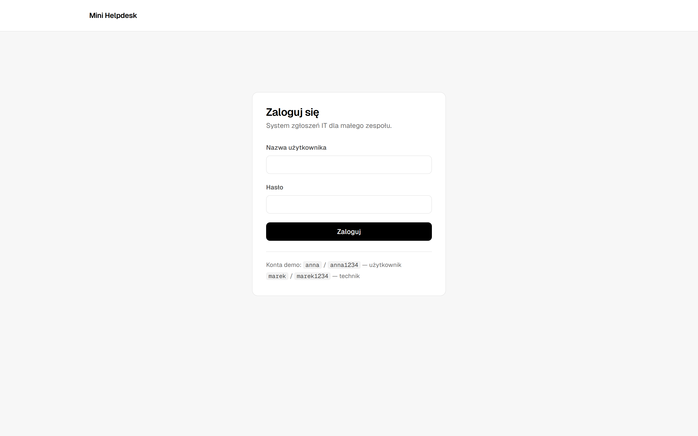
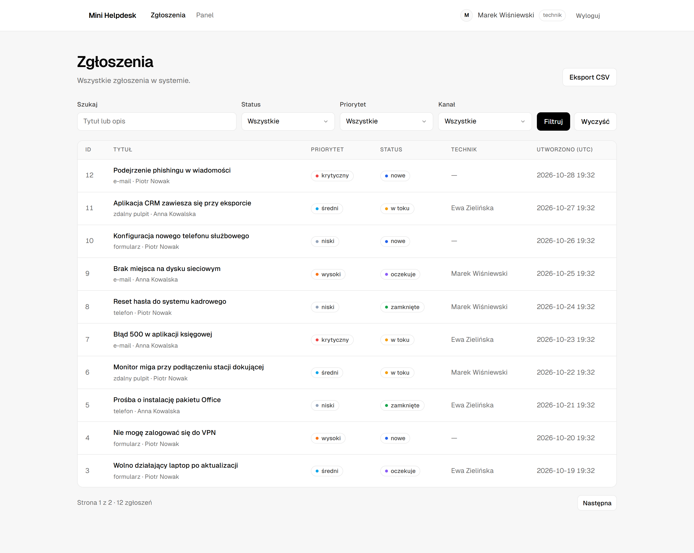
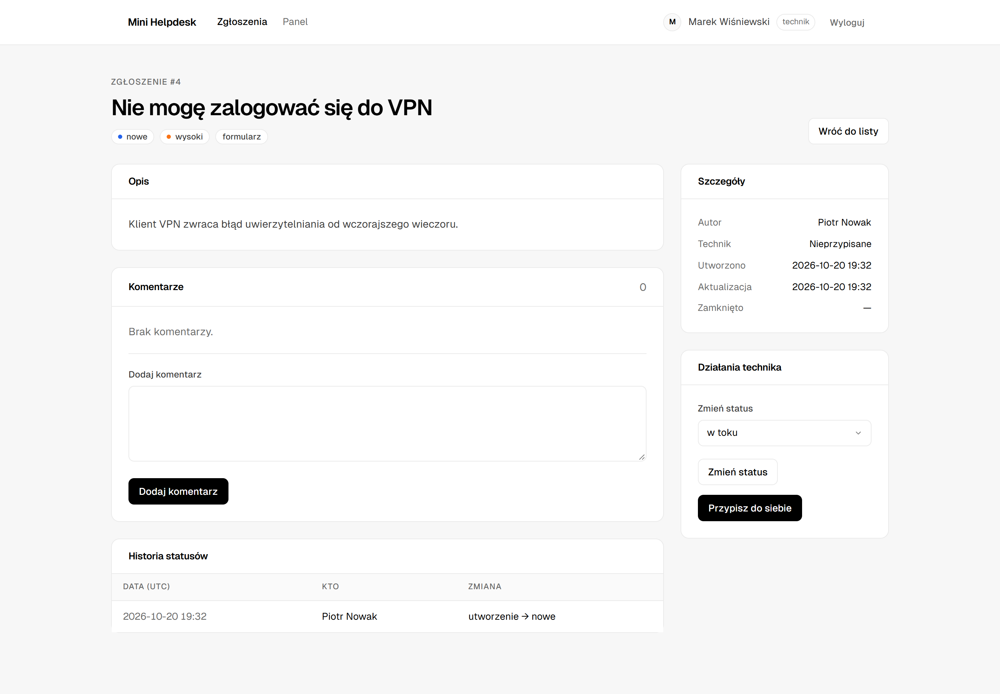
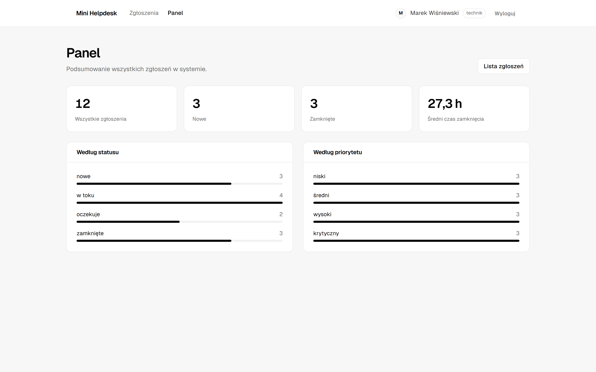

# Mini Helpdesk

Webowy system obsługi zgłoszeń IT zbudowany w Pythonie, Flasku i SQLite. Projekt
pokazuje podział na domenę, repozytoria, usługi i warstwę webową, ręcznie pisany
SQL oraz testy na kilku poziomach.

## Cel projektu

Celem jest mała, ale kompletna aplikacja helpdeskowa, która demonstruje:

- modelowanie domeny za pomocą dataclasses i `StrEnum`,
- rozdzielenie logiki biznesowej od widoków i dostępu do danych,
- bezpieczne zapytania SQL bez ORM,
- uwierzytelnianie, role i ochronę przed CSRF,
- testy jednostkowe, integracyjne i tras HTTP,
- uruchomienie lokalne oraz w Dockerze jedną komendą.

## Funkcje

- logowanie z rolami `user` i `technician`,
- tworzenie zgłoszeń przez użytkownika,
- lista zgłoszeń z filtrami statusu, priorytetu i kanału,
- wyszukiwanie tekstowe po tytule i opisie,
- stronicowanie wyników,
- szczegóły zgłoszenia z komentarzem, metadanymi i historią statusów,
- zmiana statusu przez technika,
- przypisanie zgłoszenia do siebie,
- komentarze technika,
- panel z liczbą zgłoszeń według statusu i priorytetu oraz średnim czasem
  zamknięcia,
- eksport przefiltrowanej listy do CSV,
- interfejs w języku polskim, bez JavaScriptu,
- jasny, monochromatyczny interfejs oparty o font Geist.

## Role i uprawnienia

| Operacja | `user` | `technician` |
|---|---|---|
| Logowanie | tak | tak |
| Tworzenie zgłoszenia | tak | nie |
| Podgląd własnych zgłoszeń | tak | tak |
| Podgląd wszystkich zgłoszeń | nie | tak |
| Zmiana statusu | nie | tak |
| Przypisanie do siebie | nie | tak |
| Dodawanie komentarzy | nie | tak |
| Panel podsumowania | nie | tak |
| Eksport CSV | nie | tak |

## Zrzuty ekranu

Zrzuty pochodzą z działającej aplikacji i danych z seeda.

| Logowanie | Lista zgłoszeń |
|---|---|
|  |  |

| Szczegóły zgłoszenia | Panel |
|---|---|
|  |  |

Kafel portfolio (1200 × 1200) znajduje się w
`docs/portfolio/mini-helpdesk-bento.png`, a jego źródło w pliku SVG obok.

## Stos technologiczny

- Python 3.12+ (projekt był uruchamiany również na 3.14),
- Flask 3 i Jinja2,
- własny design system oparty o zmienne CSS i font Geist (pliki lokalne,
  bez CDN),
- SQLite przez `sqlite3` i ręcznie pisane zapytania SQL,
- Flask-WTF (`CSRFProtect`),
- `werkzeug.security` do hashowania haseł,
- pytest, pytest-cov i ruff,
- gunicorn w kontenerze Docker.

## Architektura

```text
HTTP
  │
  ▼
app/web          blueprinty, sesja, CSRF, formularze, szablony
  │
  ▼
app/services     walidacja, uprawnienia, reguły biznesowe, transakcje
  │
  ▼
app/repositories SQL, mapowanie wierszy, UnitOfWork
  │
  ▼
SQLite + schema.sql
```

Zależności idą tylko w dół. Modele (`app/models`) nie importują Flaska ani
SQL-a. Repozytoria nie zawierają reguł biznesowych. Trasy nie zawierają logiki
biznesowej — jedynie odczytują request, wywołują serwis i renderują odpowiedź.

```text
mini-helpdesk/
├── app/
│   ├── __init__.py              # fabryka aplikacji, logging, handlery błędów
│   ├── config.py                # konfiguracja
│   ├── db.py                    # połączenie SQLite, PRAGMA, init_db
│   ├── cli.py                   # flask init-db
│   ├── errors.py                # wyjątki domenowe
│   ├── labels.py                # polskie etykiety i formatowanie
│   ├── models/                  # dataclasses, enumy, DTO, paginacja
│   ├── repositories/            # SQL i UnitOfWork
│   ├── services/                # logika biznesowa
│   ├── web/                     # blueprinty, CSRF, formularze
│   ├── templates/               # Jinja2
│   └── static/                  # CSS i fonty Geist
├── tests/                       # 62 testy pytest
├── docs/screenshots/            # zrzuty z działającej aplikacji
├── docs/portfolio/              # kafel portfolio (SVG + PNG)
├── schema.sql                   # DDL, indeksy i dane przykładowe
├── wsgi.py
├── Dockerfile
├── docker-compose.yml
├── requirements.txt
├── requirements-dev.txt
└── pytest.ini
```

## Model danych

Tabele: `users`, `tickets`, `comments`, `status_history`.

Zgłoszenie ma tytuł, opis, priorytet, status, kanał, autora, opcjonalnego
technika oraz daty utworzenia, aktualizacji i zamknięcia. `closed_at` jest
ustawiane tylko dla statusu `closed` — pilnuje tego ograniczenie `CHECK` w bazie.

Dozwolone przejścia statusów:

| Z | Do |
|---|---|
| `new` | `in_progress`, `closed` |
| `in_progress` | `waiting`, `closed` |
| `waiting` | `in_progress`, `closed` |
| `closed` | `in_progress` |

Każda zmiana statusu trafia do `status_history` razem z autorem i znacznikiem
czasu. Utworzenie zgłoszenia również tworzy wpis początkowy (`NULL → new`).

## Uruchomienie bez Dockera

Aplikacja nie wymaga serwera bazy danych — SQLite jest częścią standardowej
biblioteki Pythona. Potrzebny jest tylko interpreter i `pip`.

### Wymagania

- Python 3.12 lub nowszy — sprawdź `python --version`,
- `pip` dołączony do Pythona,
- wolny port `5000` (albo inny, podany jawnie),
- systemowy `sqlite3` nie jest potrzebny.

### Instalacja krok po kroku

Windows (PowerShell):

```powershell
python -m venv .venv
.venv\Scripts\Activate.ps1
python -m pip install --upgrade pip
python -m pip install -r requirements-dev.txt
Copy-Item .env.example .env
flask --app wsgi init-db
flask --app wsgi run --debug
```

Linux/macOS:

```bash
python3 -m venv .venv
source .venv/bin/activate
python -m pip install --upgrade pip
python -m pip install -r requirements-dev.txt
cp .env.example .env
flask --app wsgi init-db
flask --app wsgi run --debug
```

Aplikacja: `http://127.0.0.1:5000`.

`requirements-dev.txt` zawiera również pytest i ruff. Do samego uruchomienia
wystarczy `requirements.txt`:

```bash
python -m pip install -r requirements.txt
```

### Co robią poszczególne kroki

1. `python -m venv .venv` — tworzy izolowane środowisko w katalogu projektu.
2. Aktywacja — w promptcie pojawia się `(.venv)`. Bez aktywacji `flask` i
   `pytest` mogą wskazywać na globalny Python.
3. `pip install -r requirements-dev.txt` — Flask, Flask-WTF, gunicorn,
   python-dotenv oraz narzędzia deweloperskie.
4. `Copy-Item .env.example .env` — konfiguracja lokalna. Plik `.env` jest w
   `.gitignore`.
5. `flask --app wsgi init-db` — tworzy `instance/helpdesk.db` na podstawie
   `schema.sql` wraz z danymi przykładowymi. Komenda jest idempotentna: jeśli
   baza istnieje, nic nie zmienia.
6. `flask --app wsgi run --debug` — serwer deweloperski z auto-reloadem.
   Bez debugowania: `flask --app wsgi run`.

### Zmienne środowiskowe

| Zmienna | Domyślnie | Znaczenie |
|---|---|---|
| `SECRET_KEY` | `dev-only-change-me` | klucz sesji i tokenów CSRF |
| `DATABASE_PATH` | `instance/helpdesk.db` | ścieżka do pliku SQLite |
| `LOG_LEVEL` | `INFO` | poziom logowania |
| `SESSION_COOKIE_SECURE` | `0` | `1` wymusza cookie tylko po HTTPS |
| `APP_PORT` | `8001` | port hosta w Dockerze (bez wpływu na `flask run`) |

Flask CLI wczytuje `.env` dzięki `python-dotenv`. Przy uruchomieniu przez
gunicorna lub inny serwer WSGI ustaw zmienne w środowisku powłoki — `.env` nie
jest wtedy czytany automatycznie.

### Uruchomienie produkcyjne bez Dockera

Na serwerze Linux/macOS użyj gunicorna (Windows nie jest wspierany przez
gunicorn — tam wybierz Dockera):

```bash
export SECRET_KEY="$(python -c 'import secrets; print(secrets.token_hex(32))')"
export DATABASE_PATH=/var/lib/mini-helpdesk/helpdesk.db
flask --app wsgi init-db
gunicorn --bind 0.0.0.0:8000 --workers 2 --threads 4 wsgi:app
```

Katalog z bazą musi być zapisywalny przez użytkownika procesu. Za HTTPS i
nagłówki powinien odpowiadać reverse proxy (np. nginx).

### Reset bazy i typowe problemy

- **Nowa, czysta baza** — usuń `instance/helpdesk.db` oraz ewentualne
  `helpdesk.db-wal` i `helpdesk.db-shm`, następnie ponów `flask --app wsgi init-db`.
- **`flask: command not found`** — środowisko nie jest aktywne; uruchom
  `.venv\Scripts\Activate.ps1` (Windows) lub `source .venv/bin/activate`.
- **`ModuleNotFoundError: No module named 'app'`** — komendę uruchomiono poza
  katalogiem projektu.
- **Port 5000 zajęty** — `flask --app wsgi run --port 5001`.
- **PowerShell blokuje aktywację** —
  `Set-ExecutionPolicy -Scope Process -ExecutionPolicy Bypass`.
- **Ostrzeżenie o domyślnym `SECRET_KEY`** — ustaw własny klucz w `.env`.

## Docker

```bash
docker compose up --build
```

Aplikacja: `http://localhost:8001`.

Kontener przy starcie uruchamia `flask init-db`, a następnie gunicorna. Baza jest
przechowywana w wolumenie `helpdesk-data`, więc restart nie usuwa danych. Port
hosta można zmienić zmienną `APP_PORT`, np. `APP_PORT=8000 docker compose up`.

Zatrzymanie:

```bash
docker compose down
```

Usunięcie także danych:

```bash
docker compose down -v
```

Przed wdrożeniem ustaw własny `SECRET_KEY`, np.:

```bash
SECRET_KEY="$(python -c 'import secrets; print(secrets.token_hex(32))')" docker compose up --build
```

## Dane testowe

Konta pochodzą z `schema.sql`:

| Login | Hasło | Rola | Imię i nazwisko |
|---|---|---|---|
| `anna` | `anna1234` | user | Anna Kowalska |
| `piotr` | `piotr1234` | user | Piotr Nowak |
| `marek` | `marek1234` | technician | Marek Wiśniewski |
| `ewa` | `ewa1234` | technician | Ewa Zielińska |

Seed zawiera 12 zgłoszeń, komentarze i spójną historię statusów.

## Testy i jakość kodu

```bash
pytest
```

lub z pokryciem:

```bash
pytest --cov=app --cov-report=term-missing
```

Statyczna analiza i formatowanie:

```bash
ruff check app tests wsgi.py
ruff format --check app tests wsgi.py
```

Testy obejmują m.in.:

- logowanie i jednolity komunikat błędu,
- walidację danych wejściowych,
- filtry, wyszukiwanie i paginację,
- zakres widoczności zgłoszeń dla użytkownika,
- przejścia statusów i `closed_at`,
- przypisanie do siebie i przejęcie zgłoszenia,
- komentarze i uprawnienia,
- agregacje panelu,
- eksport CSV,
- CSRF, przekierowania i kody `403`/`404`.

Repozytoria i serwisy korzystają z bazy in-memory. Testy tras używają
tymczasowego pliku SQLite i prawdziwego klienta testowego Flaska.

## Bezpieczeństwo

- hasła są hashowane przez `werkzeug.security` (scrypt),
- CSRF jest obsługiwany przez `Flask-WTF` i `CSRFProtect`,
- sesja przechowuje tylko `user_id`; użytkownik jest doczytywany przy każdym
  requeście,
- ciasteczko sesji ma `HttpOnly` i `SameSite=Lax`,
- wszystkie zapytania SQL są parametryzowane,
- wyszukiwanie escapuje znaki `%`, `_` i `\`,
- użytkownik nie może odczytać cudzego zgłoszenia — otrzymuje `404`,
- eksport CSV neutralizuje wartości rozpoczynające się od `=`, `+`, `-`, `@`,
- zdarzenia logowania, zmiany statusu, komentarze i eksporty są logowane.

## Decyzje projektowe

- **SQLite i ręczny SQL** zamiast ORM — projekt ma pokazać świadome korzystanie
  z bazy, indeksów, ograniczeń i transakcji.
- **UnitOfWork** — jedno połączenie i wspólna transakcja dla repozytoriów;
  zapis zgłoszenia i wpisu historii jest atomowy.
- **Serwisy jako miejsce reguł** — walidacja, uprawnienia i przejścia statusów
  nie trafiają do widoków.
- **DTO** — `TicketInput` i `TicketFilter` oddzielają dane z formularza od
  modelu domenowego.
- **Własny design system zamiast frameworka CSS** — kilkaset linii CSS ze
  zmiennymi, monochromatyczna paleta i font Geist; brak zależności od CDN i brak
  JavaScriptu.
- **CSV ze średnikiem i BOM** — plik poprawnie otwiera się w polskim Excelu.
- **UTC w bazie** — daty są spójne niezależnie od strefy czasowej serwera;
  interfejs oznacza je jako UTC.

## Ograniczenia

- brak rejestracji i resetu hasła — konta pochodzą z seeda,
- brak załączników i powiadomień,
- komentarze dodaje tylko technik,
- brak edycji i usuwania zgłoszeń,
- wyszukiwanie `LIKE` jest case-insensitive tylko dla znaków ASCII,
- SQLite sprawdza się w demo i małym zespole; przy większym ruchu warto rozważyć
  PostgreSQL.

## Pomysły na rozwój

- rejestracja i zarządzanie kontami,
- załączniki do zgłoszeń,
- powiadomienia e-mail,
- kolejka i priorytety SLA,
- przypisywanie do innych techników i zespołów,
- edycja zgłoszeń oraz historia wszystkich pól,
- wyszukiwanie pełnotekstowe (SQLite FTS5),
- eksport do XLSX,
- wykresy w panelu,
- migracje bazy i Alembic,
- uruchomienie za reverse proxy z HTTPS.
